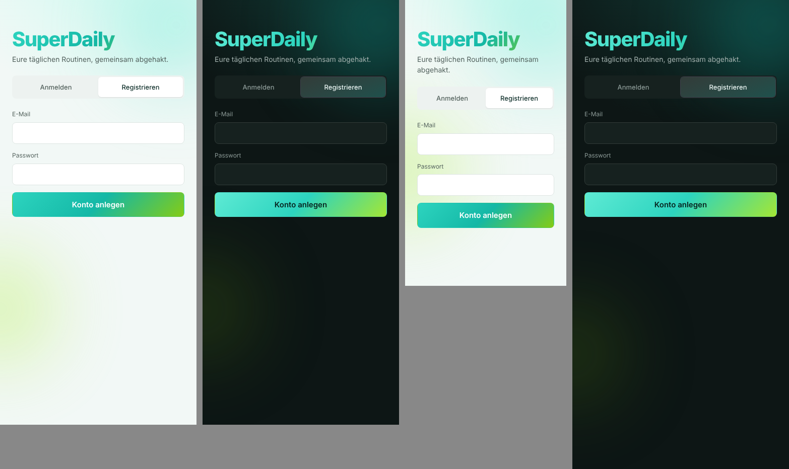
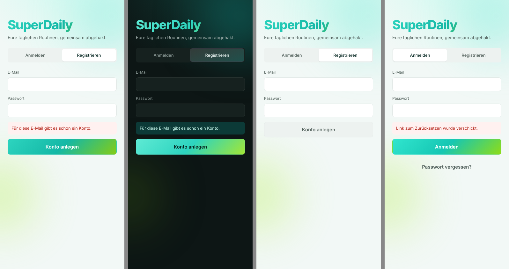
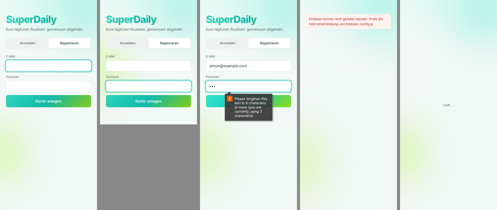

# Design-Review: Registrierungs-Screen · 15. November 2026

Bildschirmfotos zum Design-Review (Stand Version 11). Die Ergebnisse und die Checkliste stehen in Issue #34 („designreview“).

Aufgenommen im Test-Browser mit Test-Konten, nicht auf echten Handys.

## Übersichten

| Bild | Inhalt (von links nach rechts) |
| --- | --- |
|  | Registrieren: 390 hell, 390 dunkel, 320 hell, 430 dunkel |
|  | Fehler hell, Fehler dunkel, Laden, „Passwort vergessen“ |
|  | Fokus, Tastatur offen, zu kurzes Passwort, Firebase nicht erreichbar, Laden |

## Einzelbilder

| Datei | Zeigt |
| --- | --- |
| `start-anmelden-390-hell.png` | Startzustand „Anmelden“ |
| `registrieren-390-hell.png`, `registrieren-390-dunkel.png` | Registrieren, normales Handy |
| `registrieren-320-hell.png`, `registrieren-430-dunkel.png` | kleines und großes Handy |
| `fokus-email.png`, `fokus-seg.png` | Fokus-Rahmen an Feld und Umschalter |
| `tastatur-offen.png` | simulierte offene Tastatur |
| `kurzes-passwort.png` | Passwort mit 3 Zeichen (Sprechblase des Browsers) |
| `laedt.png` | Knopf während des Anlegens; Felder sind leer |
| `fehler-konto-existiert.png`, `fehler-dunkel.png` | „Für diese E-Mail gibt es schon ein Konto“ |
| `fehler-offline.png` | „Keine Verbindung.“ |
| `reset-erfolg.png` | Erfolgsmeldung im roten Kasten |
| `firebase-nicht-geladen.png` | Sackgasse ohne Knopf |
| `danach.png` | „Lädt …“ nach der Registrierung (Datenbank im Test nicht erreichbar) |
